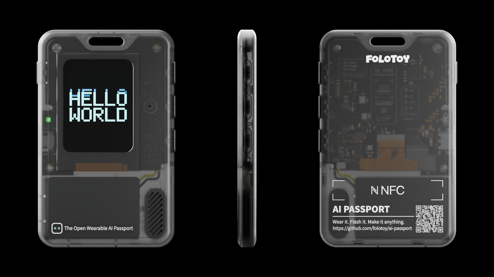

# Passport · 两个 AI Passport 玩法

[FoloToy AI Passport](https://ai-passport.folotoy.cn/) 是一块戴在身上的小屏设备：ESP32-C3、8 MB Flash、240×320 屏，右侧三颗实体键。它开放固件，刷进去就能变成别的东西。

这个仓库放的是我在它上面做的两个固件，彼此独立，可以分别构建、分别烧录：

| 目录 | 玩法 | 一句话 |
| --- | --- | --- |
| [`focus/`](focus/) | **Focus 番茄钟** | 像素风番茄钟：专注 / 短休 / 长休自动循环，进度是一只被一口口吃掉的水果 |
| [`baby_english/`](baby_english/) | **宝宝英语** | 离线英语点读卡：60 个学龄前单词，每个词一张插画 + 一段朗读 |

两个目录都是完整的 ESP-IDF 工程，`build/`、`managed_components/` 等构建产物不入库。



## 硬件与开发环境

| 项 | 值 |
| --- | --- |
| 芯片 | ESP32-C3，无 PSRAM |
| Flash | 8 MB |
| 屏幕 | 240×320 ST7789（SPI） |
| 按键 | 右侧三颗，竖排，下文记为 A（上）/ B（中）/ C（下） |
| 框架 | ESP-IDF **5.5.3** + LVGL 9 |
| 音频 | I2S 扬声器 + 麦克风（两个玩法只用到播放） |

```sh
source /path/to/esp-idf-5.5.3/export.sh
idf.py --version    # 必须是 v5.5.3
```

---

## Focus 番茄钟

把 AI Passport 改成一个只做一件事的小工具：一个番茄钟。

### 它是什么

- **经典配比**：专注 25 分钟、短休 5 分钟、长休 15 分钟，每完成 4 个专注进一次长休。
- **首页**用上下键以 5 分钟为一档调专注时长（5–90 分钟），按 OK 开始。时长直接存进 NVS，下次开机还在。
- **计时页**上半屏是一只水果，随着时间被一口口吃掉（每个水果 5 个阶段）；六种水果轮换，下一段专注开始前换一种，不会连续两次是同一只。下半屏是倒计时、阶段名、循环进度点阵和一行操作提示。
- **没有暂停**。番茄钟的一个番茄不可分割：专注中长按 OK = 放弃这一轮（作废、回首页）；休息中长按 OK = 跳过这段休息（已经走完的番茄照算）。
- **阶段结束响提示音**，可在设置页关掉。
- **掉电与深睡**：配置、阶段和累计完成的番茄都会落盘；但正在走的那一轮跨不过一次重启，唤醒后按「被打断」处理，从头开始。
- **不自动熄屏**：番茄钟的全部价值是抬头一眼看见还剩多久，所以背光全程 100%，不做调暗、熄屏或自动休眠。要省电只有长按上键主动进入深睡，按任意键唤醒。

界面是像素风：标题 `Focus`、大号倒计时数字和首页加减按钮都是点阵字形，配色只有阶段色（专注暖红 / 短休绿 / 长休蓝）和水果本身的颜色。

### 按键

| 键 | 首页 | 计时页 | 设置页 |
| --- | --- | --- | --- |
| A 上 短按 | 专注时长 +5 分钟 | — | 选中上一行 |
| B 下 短按 | 专注时长 −5 分钟 | — | 选中下一行 |
| C OK 短按 | 开始专注 | 进入下一阶段（计时中无动作） | 切换当前行的值 / 执行「恢复默认」 |
| C OK 长按 | 进设置页 | 专注中放弃本轮；休息中跳过本段 | 回首页 |
| A 上 长按 | 进入深睡 | 未开始时进设置页 | 进入深睡 |

设置页四行可调项：短休时长、长休时长、每几个番茄进长休、提示音；最后一行是恢复出厂值。

### 构建

```sh
cd focus
source /path/to/esp-idf-5.5.3/export.sh
idf.py set-target esp32c3
./tools/validate.sh --firmware     # 静态检查 + 主机单元测试 + 编译并校验合并固件
```

产物是 `build/FoloToy-AI-Passport-full.bin`。

> **刷写方式会影响存档。** 从 `0x0` 写整包合并镜像会把 NVS 分区填成 `0xFF`，番茄钟的时长设置、设置项和累计计数都会丢。要保留设备上的存档，用分段烧录：
>
> ```sh
> idf.py flash monitor
> ```

### 代码结构

纯逻辑与硬件分层，状态机不依赖 LVGL / ESP-IDF，可以在主机上直接跑单元测试：

| 文件 | 职责 |
| --- | --- |
| `main/focus_model.c` | 番茄钟状态机与时间模型（绝对截止时刻，不做每秒自减） |
| `main/focus_ui.c` | 三个页面的搭建与刷新 |
| `main/focus_app.c` | 按键 → 语义键 → 模型的装配层、LVGL 定时器与功耗任务 |
| `main/focus_store.c` | NVS 快照读写（magic + version，不合法即回默认） |
| `main/focus_fruit_math.c` | 水果轮换与啃食阶段的纯计算 |
| `main/focus_sprites.c` / `focus_scenes.c` | 水果与结束卡 / 睡觉动画的 RGB565 位图 |
| `assets/fonts/` | `focus_text_20`（Noto Sans SC 子集）与 `focus_pixel_35`（手写 5×7 点阵） |
| `tools/gen_*.py` | 精灵、场景、字体、按钮、标题的生成脚本 |

`focus/` 基于 FoloToy 开源的 AI Passport 固件（MIT）。板级 `components/bsp` 与部分工具沿用上游，界面和业务逻辑按衍生应用规则重写。

---

## 宝宝英语 · BaoBao English

面向学龄前儿童的离线英语单词点读固件，跑在同一块板子上。不联网。

### 它是什么

- **6 个主题单元、60 个常见单词**：水果、动物、颜色、数字、身体、日常用品。
- 每个词有一张 112×112 插画、一行美式音标、中文释义和一段英语朗读。中文**一直显示**，不需要翻面。
- 只有四个页面：**首页 → 单词卡片**，以及长按进入的 **设置 → 字体许可**。
- 首页固定提示「单击开始 · 长按设置」。单击任意键随机开始；卡片顺序是洗牌后不重复的 60 张，走完一轮才重洗。
- 卡片页三个按钮就是三颗键：**`A 返回` / `B 下一个` / `C 发声`**。默认不出声，想听才按。音量 80%，可在设置里调并试听。
- 60 段朗读由 macOS `say`（Samantha）本机合成、Opus 编码后内嵌在固件里，是合成音，不是真人录音。
- 闲置 60 秒熄屏；播放期间不熄屏。

### 按键

| 键 | 首页 | 单词卡片 | 设置 / 字体许可 |
| --- | --- | --- | --- |
| A 上 | 单击开始 | 返回 | 上一项 / 上一页 |
| B 中 | 单击开始 | 下一个 | 下一项 / 下一页 |
| C 下 | 单击开始 | 发声 | 确认 |
| 任意键长按 1 秒 | 进入设置 | 无动作 | 无动作 |

### 构建

```sh
cd baby_english
export BABY_IDF_PATH=/path/to/esp-idf-5.5.3
bash tools/build.sh

# 主机测试
cmake -S tests -B build-host && cmake --build build-host -j 4
ctest --test-dir build-host --output-on-failure
```

### 改内容

`content/curriculum.json` 是唯一内容来源：单词、音标、配图与音频的顺序都由它推导。换成自己的词表、配图和语音的完整步骤见 [`content/import-guide.md`](baby_english/content/import-guide.md)。

### 素材与许可

见 [`baby_english/SOURCE-NOTICE.md`](baby_english/SOURCE-NOTICE.md)：词表为自编内容；单词插画表与首页插画由项目方提供，不是本仓库自绘；朗读为本机合成。字体与组件许可分别见 `assets/fonts/FONT-NOTICES.txt` 与 `licenses/`。

---

## 仓库结构

```
.
├── focus/          # 番茄钟固件（在上游 AI Passport 工作区上改造）
│   ├── main/       # 应用分层：model / ui / app / store / sprites
│   ├── assets/     # 字体、精灵、品牌图
│   ├── tools/      # 生成与校验脚本
│   └── docs/       # 上游文档、硬件资料、开发指南
└── baby_english/   # 宝宝英语固件
    ├── main/       # 页面、内容、音频与字库
    ├── content/    # 唯一内容来源 curriculum.json
    ├── tools/      # 资源生成与构建脚本
    └── docs/       # 环境、验收与来源说明
```

仓库不含构建产物、`managed_components/`、设备备份或任何密钥。

## 许可

- `focus/` 源自 [FoloToy AI Passport](https://gitee.com/FoloToy/ai-passport)（MIT，© 2026 FoloToy）；本目录中的改动是该固件的衍生玩法。
- `baby_english/` 的源码与素材许可范围各不相同，见其 `SOURCE-NOTICE.md`。公开可见不代表全部内容采用同一种许可。
- 两个目录里如有冲突，以各自目录下的许可文件为准。
